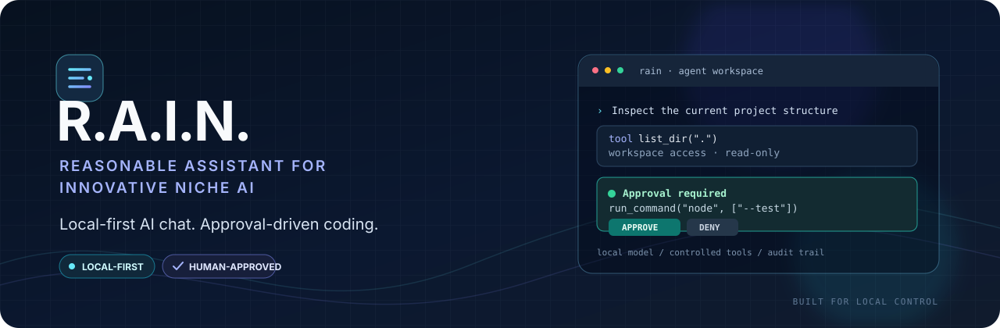

<!-- R.A.I.N. repository presentation -->
<p align="center">
  
</p>

<p align="center">
  <strong>A local-first AI workspace for conversation, code exploration, and human-approved actions.</strong>
  <br />
  Bring your own local model. Keep the workflow transparent. Stay in control.
</p>

<p align="center">
  
  
  
  
</p>

<p align="center">
  <a href="#-overview">Overview</a> ·
  <a href="#-key-capabilities">Capabilities</a> ·
  <a href="#-get-started">Get started</a> ·
  <a href="#-agent-workspace">Agent workspace</a> ·
  <a href="#-security-model">Security</a> ·
  <a href="#-api-reference">API</a>
</p>

---

## ✦ Overview

**R.A.I.N.** stands for **Reasonable Assistant for Innovative Niche AI**. It is an independent, local-first AI assistant built with Node.js core modules and browser-native technologies. It combines a lightweight chat interface with an optional coding-agent workflow that can inspect a workspace, propose file changes, and run selected commands after approval.

R.A.I.N. connects to an **OpenAI-compatible model endpoint**—for example, a local server provided by Ollama, llama.cpp, or LM Studio. It does not bundle a model, require a hosted AI API key, or add third-party npm runtime dependencies.

> **Design principle:** useful assistance should remain inspectable. R.A.I.N. makes tool activity visible and keeps approval in the loop for file writes and command execution by default.

### Project snapshot

| | |
|---|---|
| **Application** | Browser-based AI chat and optional coding agent |
| **Runtime** | Node.js 18+ |
| **Model interface** | OpenAI-compatible chat-completions API |
| **Frontend** | HTML, CSS, and vanilla JavaScript |
| **Runtime dependencies** | None beyond Node.js built-ins |
| **Default network mode** | Offline |
| **Default bind address** | `127.0.0.1` |
| **Testing** | Node.js built-in test runner |

## ✧ Key capabilities

<table>
  <tr>
    <td width="50%" valign="top">
      <strong>◈ Local-model chat</strong><br />
      Connect to a compatible model endpoint and stream responses into the browser UI.
    </td>
    <td width="50%" valign="top">
      <strong>⌘ Approval-driven agent</strong><br />
      Let the model request bounded workspace tools, with review gates before writes and commands.
    </td>
  </tr>
  <tr>
    <td width="50%" valign="top">
      <strong>⛨ Guardrails around tools</strong><br />
      Workspace containment checks, command allow-listing, execution timeouts, and output limits.
    </td>
    <td width="50%" valign="top">
      <strong>◉ Local-first network policy</strong><br />
      Offline mode restricts R.A.I.N.'s guarded provider requests to recognized loopback hosts.
    </td>
  </tr>
  <tr>
    <td width="50%" valign="top">
      <strong>≋ Visible activity and audit trail</strong><br />
      Tool decisions are recorded in a JSON Lines audit log for later inspection.
    </td>
    <td width="50%" valign="top">
      <strong>◇ Lightweight by design</strong><br />
      No framework or third-party npm runtime packages are required by the current application.
    </td>
  </tr>
</table>

## ◈ Architecture

```text
┌──────────────────────┐
│    Browser UI        │
│ Chat · Stream · UI   │
└──────────┬───────────┘
           │ HTTP / NDJSON
           ▼
┌──────────────────────┐
│   Node.js server     │
│ Routes · Validation  │
│ Limits · Net policy  │
└──────────┬───────────┘
           │
      ┌────┴───────────────┐
      ▼                    ▼
┌───────────────┐   ┌────────────────────┐
│ Model adapter │   │ Agent orchestration│
│ Chat stream   │   │ Tool loop + review │
└───────┬───────┘   └─────────┬──────────┘
        │                     │
        ▼                     ▼
┌───────────────┐   ┌────────────────────┐
│ Local model   │   │ Workspace tools     │
│ API endpoint  │   │ + approval + audit  │
└───────────────┘   └────────────────────┘
```

The browser talks to the local Node.js server. The server validates requests and forwards model traffic through the provider adapter. In agent mode, the model can request tools; R.A.I.N. validates each request and gates write and command actions according to the configured approval policy.

## 🚀 Get started

### Prerequisites

- **Node.js 18 or newer**
- A local model runtime and a model supported by that runtime
- A modern browser

### 1. Start a compatible model server

Pick one option.

<details>
  <summary><strong>Option A — Ollama</strong></summary>

Install [Ollama](https://ollama.com/) and download a model:

```bash
ollama pull llama3.2
```

Start the Ollama service. Its usual local API address is `http://127.0.0.1:11434`.
</details>

<details>
  <summary><strong>Option B — llama.cpp</strong></summary>

Start `llama-server` with a local GGUF model:

```bash
llama-server -m /path/to/your-model.gguf --port 8080
```

Use `http://127.0.0.1:8080` as the base URL.
</details>

<details>
  <summary><strong>Option C — LM Studio</strong></summary>

Load a model in LM Studio and start its OpenAI-compatible API server. Configure R.A.I.N. with the server's base URL and the model identifier expected by that runtime.
</details>

### 2. Configure R.A.I.N. (optional)

Copy the example environment file to `.env` in the repository root.

**Git Bash, macOS, or Linux**
```bash
cp .env.example .env
```

**Windows Command Prompt**
```bat
copy .env.example .env
```

The default values target a typical local Ollama setup. If your model server uses another address or model name, update these settings:

```dotenv
LOCAL_MODEL_URL=http://127.0.0.1:11434
LOCAL_MODEL_NAME=llama3.2
DEFAULT_MODE=offline
```

### 3. Launch the application

From the repository root:

```bash
node src/server.js
```

Open **http://127.0.0.1:3000** in your browser. Keep your model server running while using the app.

No `npm install` is needed for the current project: it uses Node.js built-ins and has no third-party runtime dependencies.

### 4. Run the tests

```bash
npm test
```

This runs the project's tests with Node's built-in test runner.

## ⚙️ Configure the model

R.A.I.N. expects an OpenAI-compatible base URL that provides:

- `GET /v1/models` — model connection/status check
- `POST /v1/chat/completions` — chat and agent requests

Set `LOCAL_MODEL_URL` to the **base URL**, not the full chat-completions path. The model identifier in `LOCAL_MODEL_NAME` must match what your runtime accepts.

Model compatibility varies. Some models support native tool calls; others may rely on the agent's JSON-in-text fallback. Chat quality, tool reliability, and response speed depend on the selected model, runtime configuration, and hardware.

## ⌘ Agent workspace

Enable **Agent (tools)** in the interface to use the coding-agent workflow. The agent can request one of the tools below.

| Tool | Purpose | Approval |
|---|---|---|
| `list_dir` | List entries inside the workspace | Not required |
| `read_file` | Read a UTF-8 text file inside the workspace | Not required |
| `write_file` | Create or overwrite a text file | Required by default |
| `run_command` | Execute a permitted program with arguments | Always required |

The workspace defaults to `./workspace` at the project root and is created when the server starts. Use workspace-relative paths.

### Approval and execution policy

- Pending writes and commands show an **Approve / Deny** prompt.
- If approval is not received before `APPROVAL_TIMEOUT_MS`, the action is denied.
- `AUTO_APPROVE_WRITES=true` bypasses approval for `write_file` only. **Command execution still always requires approval.**
- `AGENT_MAX_STEPS` and related limits bound the agent loop.
- Tool decisions are appended to `data/audit.log` in JSON Lines format. The log records tool decisions and summaries, not full file contents.

**Recommended workflow:** ask the agent to inspect the workspace first, review every proposed path and command, and keep backups of files that matter.

## 🧩 Configuration reference

All settings are optional. Defaults below reflect the current application configuration and `.env.example`.

| Variable | Default | Purpose |
|---|---|---|
| `HOST` | `127.0.0.1` | HTTP server bind address; keep loopback for local-only use. |
| `PORT` | `3000` | HTTP server port. |
| `LOCAL_MODEL_URL` | `http://127.0.0.1:11434` | Model server base URL. |
| `LOCAL_MODEL_NAME` | `llama3.2` | Model identifier sent with API requests. |
| `DEFAULT_MODE` | `offline` | Initial network mode: `offline` or `online`. |
| `REQUEST_TIMEOUT_MS` | `120000` | Chat request timeout. |
| `RATE_LIMIT_PER_MIN` | `30` | Chat/agent request limit per client IP per rolling minute. |
| `MAX_MESSAGE_CHARS` | `8000` | Maximum characters per message. |
| `MAX_CONTEXT_CHARS` | `24000` | Approximate chat-context character budget. |
| `MAX_BODY_BYTES` | `262144` | Maximum JSON request body size. |
| `MAX_MESSAGES` | `100` | Maximum messages accepted in a request. |
| `WORKSPACE_DIR` | `./workspace` | Directory accessible to agent tools. Relative values resolve from the process working directory. |
| `AUTO_APPROVE_WRITES` | `false` | Skip approval prompts for file writes only. |
| `ALLOWED_COMMANDS` | `node,python3,python` | Comma-separated permitted program names. |
| `AGENT_MAX_STEPS` | `8` | Maximum model/tool loop steps per task. |
| `AGENT_MAX_CALLS_PER_STEP` | `4` | Maximum native tool calls handled in a step. |
| `AGENT_MAX_CONTEXT_CHARS` | `60000` | Agent context character budget. |
| `AGENT_TIMEOUT_MS` | `600000` | Overall agent-task timeout. |
| `APPROVAL_TIMEOUT_MS` | `120000` | Time to wait for a tool approval. |
| `COMMAND_TIMEOUT_MS` | `30000` | Maximum runtime for an approved child process. |
| `MAX_FILE_BYTES` | `200000` | Maximum size of files read or written by tools. |
| `TOOL_OUTPUT_MAX` | `8000` | Maximum tool-output characters passed to the model. |
| `CMD_OUTPUT_MAX` | `20000` | Maximum combined command-output characters retained. |

The configuration loader also supports `SYSTEM_PROMPT`. See `src/config.js` for the source of truth.

## 🌐 API reference

| Method | Route | Purpose |
|---|---|---|
| `GET` | `/` | Serves the browser interface. |
| `GET` | `/api/health` | Returns mode, model name, and model reachability. |
| `POST` | `/api/mode` | Changes the active network mode. |
| `POST` | `/api/chat` | Streams chat response events as newline-delimited JSON (NDJSON). |
| `POST` | `/api/agent` | Streams agent response, tool, approval, and error events as NDJSON. |
| `POST` | `/api/approve` | Resolves a pending tool approval. |

Example chat request:

```json
{
  "messages": [
    { "role": "user", "content": "Explain this function." }
  ]
}
```

The final message must be from the user. Supported roles are `user` and `assistant`. Streaming routes emit one JSON object per line; chat responses include `delta` events and a final `done` event.

## 🗂️ Project structure

```text
.
├── assets/
│   └── rain-banner.svg     # Repository banner artwork (SVG source)
├── public/
│   ├── index.html          # Chat interface
│   ├── app.js              # Streaming, approvals, and browser history
│   └── style.css           # Responsive UI styles
├── src/
│   ├── server.js           # HTTP server, routes, and request safeguards
│   ├── config.js           # Environment loading and configuration
│   ├── validate.js         # Request validation and context trimming
│   ├── netguard.js         # Outbound-request policy
│   ├── providers/
│   │   └── local.js        # OpenAI-compatible model adapter
│   └── agent/
│       ├── tools.js        # Workspace tools and command execution
│       ├── loop.js         # Agent loop and approvals
│       └── audit.js        # JSONL audit logging
├── test/
│   ├── server.test.js      # Server, validation, and network tests
│   └── agent.test.js       # Tool and agent tests
├── data/                   # Runtime settings and audit log
├── workspace/              # Agent-accessible workspace
├── .env.example            # Example environment configuration
└── package.json
```

Runtime files such as settings, audit logs, and workspace content may be created while the application runs.

## 🧪 Tests

Run the complete test suite:

```bash
npm test
```

The existing tests cover request validation, context trimming, offline network policy, streaming responses, invalid requests, host/origin checks, rate limiting, workspace path containment, tool approvals, command allow-listing, timeouts, and child-process environment reduction.

## ⛨ Security model and limitations

R.A.I.N. includes several safeguards for a local developer tool, but **it is not a hardened sandbox**.

- **Approved commands run with your OS user's permissions.** The workspace is their working directory, not a security boundary. An approved program may access other files available to that user or make network requests.
- **Offline mode is not a system firewall.** It governs R.A.I.N.'s guarded outbound requests and cannot constrain a program launched through an approved command.
- **Keep the server local.** The default host is `127.0.0.1`. Do not expose the server publicly without adding authentication, access controls, and a security review.
- **Treat model output as untrusted.** Review proposed writes, paths, commands, and arguments. AI-generated actions can be incorrect or destructive.
- **Protect sensitive information.** Do not put credentials, private keys, or production data in the agent workspace.
- **Use OS/container isolation for higher-risk tasks.** A disposable container or separate low-privilege account offers stronger separation than application-level checks alone.

The project uses host/origin checks, input limits, rate limiting, content-security headers, workspace path checks, timeouts, output caps, and audit logging. These reduce risk; they do not eliminate it.

## 🛠️ Troubleshooting

<details>
  <summary><strong>“Local model not reachable”</strong></summary>

  1. Confirm the model server is running.
  2. Verify `LOCAL_MODEL_URL` is the correct base URL.
  3. Confirm the runtime exposes `/v1/models` and `/v1/chat/completions`.
  4. Check that `LOCAL_MODEL_NAME` matches the expected model identifier.
</details>

<details>
  <summary><strong>Requests are blocked in offline mode</strong></summary>

  Offline mode only permits recognized loopback hostnames. If the model server is on another machine or uses a non-loopback hostname, switch to online mode only if you understand and accept the implications.
</details>

<details>
  <summary><strong>Responses are slow or time out</strong></summary>

  Speed depends on model size, hardware, context length, and runtime settings. Try a smaller or more quantized model, reduce conversation history, or increase `REQUEST_TIMEOUT_MS` when a longer wait is appropriate.
</details>

<details>
  <summary><strong>Agent tool calls are unreliable</strong></summary>

  Some local models do not support native tool calling. The JSON-in-text fallback is model-dependent; try a coding model with reliable tool-use support and review server logs for errors.
</details>

<details>
  <summary><strong>The agent cannot access a path</strong></summary>

  Paths must remain inside `WORKSPACE_DIR`. Absolute paths, parent-directory traversal, and symlink escapes are rejected intentionally. Place files the agent needs inside the configured workspace.
</details>

<details>
  <summary><strong>Port 3000 is already in use</strong></summary>

  Set a different port in `.env`, such as `PORT=3001`, restart the server, and open the corresponding local URL.
</details>

## 🧭 Potential next steps

These are possible future directions, not claims of existing functionality:

- Additional provider adapters behind the same interface
- Clearer task history and agent-session controls
- Expanded automated security and compatibility tests
- Optional isolated command execution through containers
- Explicitly designed retrieval or web-access integrations

## 🤝 Contributing

Bug reports, issues, and focused pull requests are welcome. For reproducible reports, include your Node.js version, operating system, model runtime, relevant configuration with secrets removed, and steps to reproduce the issue.

Changes involving agent tools, command execution, or network behavior should include tests and document any new security assumptions.

## 📄 License

No `LICENSE` file was identified during this README review. Until a license is added, do not assume the code is available for unrestricted reuse. If you intend to publish the project for reuse or accept outside contributions, add an appropriate license.

---

<p align="center">
  <strong>R.A.I.N.</strong><br />
  <sub>Local-first by default. Transparent by design. Human approval in the loop.</sub>
</p>
