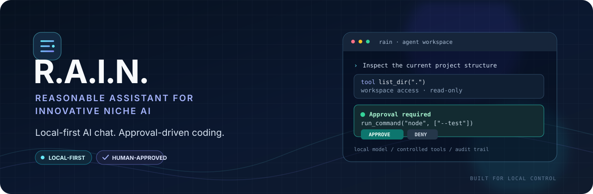

<!--
  R.A.I.N. — Reasonable Assistant for Innovative Niche AI
  Project documentation
-->

<div align="center">
  

  <p><strong>A local-first AI chat platform with an approval-driven coding agent.</strong></p>

  <p>
    
    
    
    
    
  </p>

  <p>
    <a href="#-overview">Overview</a> ·
    <a href="#-features">Features</a> ·
    <a href="#-quick-start">Quick start</a> ·
    <a href="#-user-manual">User manual</a> ·
    <a href="#-configuration">Configuration</a> ·
    <a href="#-api-reference">API</a> ·
    <a href="#-development">Development</a>
  </p>
</div>

---

## 🧠 Overview

**R.A.I.N.** stands for **Reasonable Assistant for Innovative Niche AI**. It is a self-hosted, local-first AI chat application built with Node.js and browser-native technologies.

R.A.I.N. connects to a model server running on your machine through an OpenAI-compatible API. Alongside normal streaming chat, it offers an optional agent that can inspect a dedicated workspace, create and edit files, run approved programs, and—in Online mode—read public web pages.

The project is designed around a simple principle:

> Keep the model local by default. Keep consequential actions visible and under the user's control.

R.A.I.N. does not bundle an AI model. You provide a compatible local model server, such as **Ollama**, **LM Studio**, or **llama.cpp's llama-server**.

## ✨ Features

### Chat experience
- Streamed assistant responses.
- Local conversation history stored in the browser.
- Edit and resend a previous user message.
- Regenerate the latest assistant response.
- Export a conversation as a Markdown file.
- Light and dark themes, with system-theme support.
- Responsive interface with keyboard shortcuts.

### Agent workspace
- Optional agent mode, separate from ordinary chat.
- List directories and read text files in a dedicated workspace.
- Create or overwrite workspace files.
- Run allow-listed programs without invoking a shell.
- Inspect tool calls and their output in the conversation.
- Stop a running task.
- Configurable step, execution-time, file-size, and output limits.

### Network and safety controls
- **Offline mode** is the default; network access is restricted to localhost.
- **Online mode** makes public-page fetching available to the Agent only.
- Every file write, command execution, and web fetch requires approval by default.
- Commands are restricted to a configurable allow-list.
- Workspace paths are checked to prevent traversal outside the workspace, including symlink escapes.
- Request size limits, per-IP rate limiting, request timeouts, and security headers.
- Agent activity can be written to an audit log.

## 🧰 Technology

| Area | Implementation |
|---|---|
| Runtime | Node.js 18 or newer |
| Backend | Node.js built-in HTTP server |
| Frontend | HTML, CSS, and vanilla JavaScript |
| Model interface | OpenAI-compatible chat completions API |
| Streaming | Server-Sent-style data over NDJSON |
| Dependencies | No third-party runtime packages |
| Tests | Node.js built-in test runner |

## 🚀 Quick start

### 1. Prerequisites

Install:

- **Node.js 18+** — [nodejs.org](https://nodejs.org/)
- A local model server that exposes an OpenAI-compatible API. The easiest starting point is [Ollama](https://ollama.com/).

Verify Node.js and npm are available:

```bash
node --version
npm --version
```

The application itself has no npm runtime dependencies.

### 2. Clone the project

```bash
git clone https://github.com/OrpanAp/Reasonable-Assistant-for-Innovative-Niche-AI.git
cd Reasonable-Assistant-for-Innovative-Niche-AI
```

### 3. Configure the environment

Create a local `.env` file from the example.

**macOS / Linux / Git Bash**
```bash
cp .env.example .env
```

**Windows PowerShell**
```powershell
Copy-Item .env.example .env
```

The defaults are suitable for a local Ollama server. You can start without changing anything if Ollama is listening at `http://127.0.0.1:11434` and you use the default model name.

### 4. Install and start a local model

Install Ollama from [ollama.com](https://ollama.com/), then download the default model:

```bash
ollama pull llama3.2
```

Make sure the Ollama service is running. In a separate terminal, you can check its model list:

```bash
ollama list
```

If you choose another model, update `LOCAL_MODEL_NAME` in `.env` to match the model name available to your local server.

> **Alternative model servers:** R.A.I.N. sends requests to `/v1/chat/completions` and checks `/v1/models`. Configure `LOCAL_MODEL_URL` and `LOCAL_MODEL_NAME` for an OpenAI-compatible server. For llama.cpp, the example URL is `http://127.0.0.1:8080`.

### 5. Start R.A.I.N.

From the project directory:

```bash
node src/server.js
```

You should see a startup message similar to:

```text
R.A.I.N. running at http://127.0.0.1:3000 (mode: offline, model: llama3.2 @ http://127.0.0.1:11434)
```

Open **http://127.0.0.1:3000** in your browser.

### 6. Verify the connection

Open this endpoint in your browser:

```text
http://127.0.0.1:3000/api/health
```

A healthy response has this general shape:

```json
{
  "ok": true,
  "mode": "offline",
  "model": "llama3.2",
  "modelReachable": true
}
```

If `modelReachable` is `false`, check that the model server is running, the URL is correct, and the configured model is available.

---

## 📖 User manual

### 1. Understand the main controls

| Control | What it does |
|---|---|
| **Message box** | Enter a prompt and send it to the model. |
| **Enter** | Send the current message. |
| **Shift + Enter** | Insert a new line without sending. |
| **Stop** | Stop the current response or agent task. |
| **Offline / Online** | Choose the network policy. |
| **Agent** | Allow the model to use the workspace tools. |
| **New chat** | Clear the current conversation from the interface and saved browser history. |
| **Export** | Download the current conversation as Markdown. |
| **Theme** | Switch between light and dark appearance. |

The status indicator shows whether the local model server can be reached.

### 2. Start a normal chat

1. Start the R.A.I.N. server and your local model server.
2. Open the application in your browser.
3. Confirm the status indicator reports that the model is ready.
4. Leave **Agent** turned off.
5. Type a question or instruction and press **Enter**.
6. The response streams into the conversation.

Normal chat sends prompts to the configured local model endpoint. It does not use the Agent's workspace tools.

### 3. Use the Agent

The Agent is optional. Turn on the **Agent** switch when you want the model to work with files or execute a task in its workspace.

Example prompts:

- "Inspect the project files and explain the folder structure."
- "Create a JavaScript file that prints the first ten Fibonacci numbers."
- "Read the test files and explain what they cover."
- "Run the project's test suite."

The Agent can use these tools:

| Tool | Capability | Approval |
|---|---|---|
| `list_dir` | List a workspace directory. | No |
| `read_file` | Read a UTF-8 text file. | No |
| `write_file` | Create or overwrite a workspace file. | Yes by default |
| `run_command` | Run an allowed program in the workspace. | Always |
| `fetch_url` | Read a public web page. | Yes by default; Online mode only |

The Agent works inside the configured `WORKSPACE_DIR`. It does not have unrestricted access to your project or entire computer through these tools.

### 4. Review an approval request

When the Agent wants to perform an action that needs approval:

1. Read the approval card and inspect the proposed action.
2. Use **Approve** only if you understand and trust the action.
3. Use **Deny** if it is unexpected, unsafe, or unnecessary.
4. If you do not respond before the approval timeout, the action is denied.

**Important:** approving a command allows the selected program and arguments to run. Review them carefully. The command allow-list reduces the available programs, but an allowed program can still perform consequential operations.

By default, file writes and web fetches also require approval. The command tool always requires approval.

### 5. Offline and Online modes

**Offline mode**
- Default mode on first run.
- Network requests are restricted to localhost.
- Normal chat uses your configured local model server.
- The Agent can inspect and work in its workspace.
- The Agent cannot use `fetch_url`.

**Online mode**
- Makes the Agent's read-only `fetch_url` tool available.
- Each page fetch requires approval by default.
- Normal chat still uses the configured model server; switching to Online does not turn normal chat into a cloud AI service.

Web page contents are treated as untrusted information. Do not follow instructions found inside fetched pages simply because the page contains them.

### 6. Conversation history and export

- Conversation history is saved in the browser's local storage.
- **New chat** clears the current conversation in the application.
- **Export** downloads the current conversation as a timestamped `.md` file.
- Exported conversations may contain private prompts or information. Store and share them carefully.

### 7. Keyboard shortcuts

| Shortcut | Action |
|---|---|
| `Enter` | Send message |
| `Shift + Enter` | Add a new line |
| `Esc` | Stop generation or the active task |
| `Ctrl + K` / `Cmd + K` | Start a new chat |
| `/` | Focus the message box |

---

## ⚙️ Configuration

All supported settings are documented in `.env.example`. Values are optional; defaults are applied when a value is omitted.

| Variable | Default | Purpose |
|---|---|---|
| `HOST` | `127.0.0.1` | Interface address for the HTTP server. |
| `PORT` | `3000` | HTTP server port. |
| `LOCAL_MODEL_URL` | `http://127.0.0.1:11434` | Base URL of the local OpenAI-compatible model server. |
| `LOCAL_MODEL_NAME` | `llama3.2` | Model identifier sent to the provider. |
| `DEFAULT_MODE` | `offline` | Initial network mode: `offline` or `online`. |
| `REQUEST_TIMEOUT_MS` | `120000` | Normal chat request timeout. |
| `RATE_LIMIT_PER_MIN` | `30` | Maximum chat/agent requests per IP per minute. |
| `MAX_MESSAGE_CHARS` | `8000` | Maximum length of an individual message. |
| `MAX_CONTEXT_CHARS` | `24000` | Maximum normal chat context size. |
| `WORKSPACE_DIR` | `./workspace` | Directory the Agent may access. |
| `AUTO_APPROVE_WRITES` | `false` | If `true`, workspace file writes do not ask for approval. |
| `ALLOWED_COMMANDS` | `node,python3,python` | Comma-separated executable allow-list. |
| `AGENT_MAX_STEPS` | `12` | Maximum agent loop steps. |
| `COMMAND_TIMEOUT_MS` | `30000` | Maximum command execution time. |
| `AUTO_APPROVE_FETCH` | `false` | If `true`, web fetches do not ask for approval. |
| `FETCH_TIMEOUT_MS` | `15000` | Web fetch timeout. |
| `FETCH_MAX_BYTES` | `1000000` | Maximum response size for a fetched page. |

Additional advanced limits are available in `.env.example` and `src/config.js`, including request-body size, message count, agent timeout, approval timeout, file size, tool output, command output, and agent context limits.

### Example: use a different model server

Edit `.env`:

```dotenv
HOST=127.0.0.1
PORT=3000
LOCAL_MODEL_URL=http://127.0.0.1:8080
LOCAL_MODEL_NAME=your-model-name
DEFAULT_MODE=offline
```

Use the URL and model identifier expected by your chosen OpenAI-compatible server, then restart R.A.I.N.

### Security recommendations

- Keep `HOST=127.0.0.1` for personal use.
- Do not expose this development server directly to the public internet. The application does not implement user accounts or authentication.
- Keep `AUTO_APPROVE_WRITES=false` and `AUTO_APPROVE_FETCH=false` unless you have a specific, understood reason to change them.
- Keep the command allow-list as narrow as possible.
- Do not put API keys, passwords, or other secrets in prompts or workspace files unless you understand the risks.
- Do not commit your `.env` file. The repository's `.gitignore` excludes it.
- Treat approval prompts as security decisions, not routine pop-ups.

---

## 🔌 API reference

R.A.I.N. exposes a small HTTP API. The browser interface is the recommended way to use it.

| Method | Endpoint | Purpose |
|---|---|---|
| `GET` | `/api/health` | Check server and model status. |
| `POST` | `/api/mode` | Change between Offline and Online modes. |
| `POST` | `/api/chat` | Send a normal chat request. |
| `POST` | `/api/agent` | Start an Agent task. |
| `POST` | `/api/approve` | Approve or deny a pending Agent action. |

### Health check

```bash
curl http://127.0.0.1:3000/api/health
```

### Change network mode

```bash
curl -X POST http://127.0.0.1:3000/api/mode \
  -H "Content-Type: application/json" \
  -d '{"mode":"offline"}'
```

Use `"online"` to enable Online mode.

### Chat and Agent request body

Both endpoints accept a JSON object containing a `messages` array:

```json
{
  "messages": [
    { "role": "user", "content": "Explain what this project does." }
  ]
}
```

The chat and Agent endpoints return newline-delimited JSON (NDJSON) streams. Chat events contain response `delta` values and a final `done` event. Agent streams can also include step, tool-call, tool-result, and approval events.

### Respond to an approval

The browser sends a request like this when the user chooses Approve or Deny:

```json
{
  "id": "approval-id-from-the-agent-event",
  "approve": true
}
```

Set `approve` to `false` to deny the action. The ID must refer to a currently pending approval.

---

## 🗂️ Project structure

```text
.
├── assets/
│   └── rain-banner.svg       # Project README banner
├── public/
│   ├── app.js                # Browser application logic
│   ├── favicon.svg
│   ├── index.html            # Main interface
│   └── style.css             # Application styles
├── src/
│   ├── agent/
│   │   ├── audit.js          # Agent activity audit logging
│   │   ├── loop.js           # Agent orchestration and tool loop
│   │   └── tools.js          # Workspace, command, and web tools
│   ├── providers/
│   │   └── local.js          # OpenAI-compatible local model provider
│   ├── config.js             # Environment and default configuration
│   ├── netguard.js           # Network policy and guarded fetching
│   ├── server.js             # HTTP server and API routes
│   └── validate.js           # Chat input validation
├── test/
│   ├── agent.test.js
│   ├── robustness.test.js
│   ├── server.test.js
│   └── web.test.js
├── .env.example              # Documented environment template
├── .gitignore
└── package.json
```

Runtime-created directories such as `workspace/` and `data/` are not required to exist in the repository beforehand.

---

## 🧪 Development

### Run the test suite

No dependency installation is required:

```bash
npm test
```

This runs the project tests using Node.js's built-in test runner.

### Start the server during development

```bash
npm start
```

Or run the entry point directly:

```bash
node src/server.js
```

### Suggested contribution workflow

1. Fork the repository.
2. Create a feature branch.
3. Make a focused change.
4. Run `npm test`.
5. Check the application manually with a local model server.
6. Open a pull request with a clear description and test notes.

---

## ❓ Troubleshooting

| Problem | What to check |
|---|---|
| **Local model not reachable** | Start Ollama or your model server; verify `LOCAL_MODEL_URL`; check `/api/health`. |
| **Model not found / provider error** | Confirm `LOCAL_MODEL_NAME` matches a model available on your provider. |
| **Agent says a task is already running** | Wait for the current task or press **Stop**. |
| **Agent cannot see a file** | Confirm the file is inside `WORKSPACE_DIR`; the Agent cannot browse arbitrary paths. |
| **Command is not allowed** | Add the executable name to `ALLOWED_COMMANDS`, then restart the server. Commands still require approval. |
| **Web fetch is unavailable** | Switch to Online mode and approve the fetch request. |
| **Port is already in use** | Change `PORT` in `.env` and restart. |
| **Settings do not seem to reset** | The selected network mode is persisted in the runtime settings file under `data/`; change it in the UI or remove that runtime settings file while the server is stopped. |

For bugs and feature requests, please open a GitHub issue with reproduction steps and relevant logs. Remove secrets and private data before sharing logs.

---

## 🛣️ Project direction

R.A.I.N. is an evolving project. The current codebase focuses on local chat, a bounded workspace agent, explicit approvals, and controlled optional web reading. Future ideas should be tracked as issues or discussed before being treated as implemented functionality.

## 🤝 Contributing

Contributions, bug reports, and thoughtful suggestions are welcome. Please keep changes focused, preserve the local-first defaults, and include tests for behavior changes where practical.

## 📄 License

No license file is currently present in this repository. Unless a license is added, do not assume that the code is available for unrestricted reuse, modification, or redistribution.

---

<div align="center">
  <strong>R.A.I.N. — Local intelligence. Human control.</strong>
  <br />
  Built by <a href="https://github.com/OrpanAp">OrpanAp</a>
  <br /><br />
  <a href="https://github.com/OrpanAp/Reasonable-Assistant-for-Innovative-Niche-AI">Repository</a> ·
  <a href="https://github.com/OrpanAp/Reasonable-Assistant-for-Innovative-Niche-AI/issues">Issues</a>
</div>
